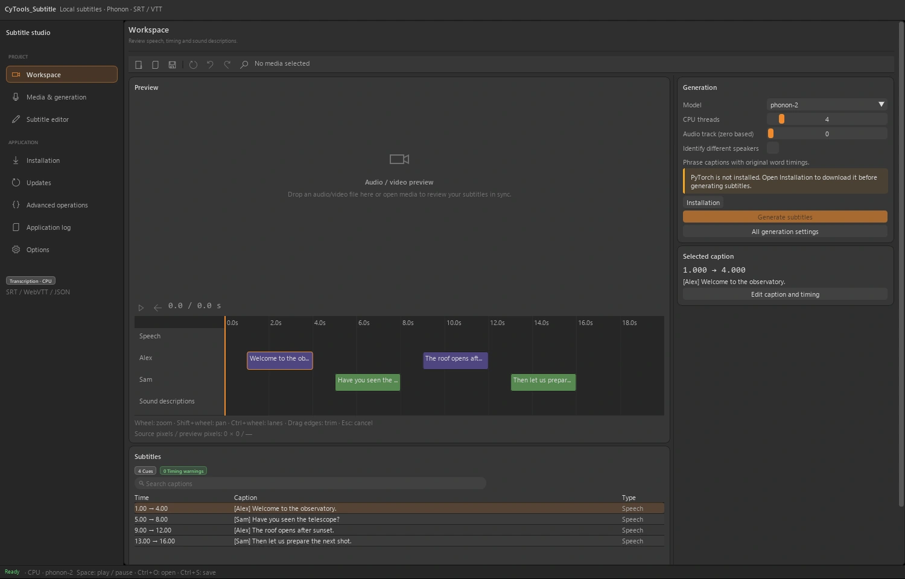
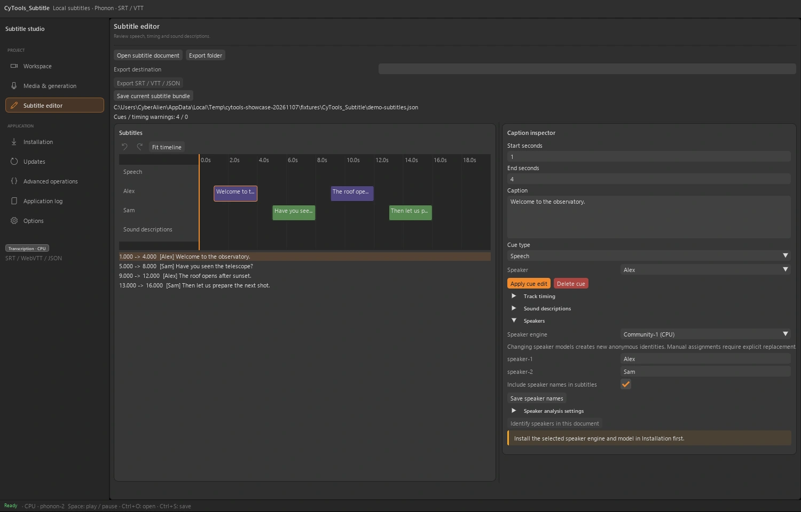

<table width="100%">
  <tr>
    <td width="300" align="left" valign="top">
      <a href="website/README.md#build-and-preview">Site web (version locale)</a><br>
      <a href="app/Documentation/Documentation.html#/fr/overview">Documentation hors ligne</a><br>
      <a href="https://github.com/MrMybal/CyTools_Subtitle">GitHub</a><br><br>
      <sub>README</sub><br>
      <a href="README.md">English</a> · <a href="README.fr.md">Français</a>
    </td>
    <td width="400" align="center" valign="middle">
      <strong>CyTools Subtitle</strong>
    </td>
    <td width="300" align="right" valign="top">
      <p><sub>Licence de l’application</sub><br><a href="LICENSE"><strong>AGPL-3.0-only</strong></a></p>
      <p><sub>Version de l’application</sub><br><a href="VERSION.fr.md"><strong>0.7.2</strong></a><br><strong>EXPÉRIMENTAL</strong></p>
      <p><a href="https://github.com/MrMybal/CyTools_Subtitle/releases/download/v0.7.2/CyTools_Subtitle-0.7.2-windows-x64.zip"><strong>Télécharger</strong></a><br><sub>Windows x64 · portable · compte autorisé</sub></p>
    </td>
  </tr>
</table>

<h1 align="center">CyTools Subtitle</h1>


Transcrivez vos médias locaux, vérifiez les mots et leur timing, puis corrigez les sous-titres avec le lecteur synchronisé. Ajoutez l’analyse des locuteurs et exportez le résultat. Pour les vidéastes, les monteurs et toute personne qui doit relire et corriger des sous-titres locaux.

> **EXPÉRIMENTAL · 0.7.2**
>
> Version Windows publiée pour évaluation ; certains parcours des moteurs restent à valider. Consultez les [notes de version et limites connues](VERSION.fr.md).

[](website/assets/showcase/workspace.webp)

*Espace sous-titres · texte de démonstration rédigé manuellement, sans affirmation sur la qualité de transcription.*


## L’application

### Transcription locale

La transcription Phonon produit texte et horodatages depuis les médias locaux compatibles. Installez séparément le moteur et le modèle, puis contrôlez le résultat dans l’application.

### Relecture et correction

Utilisez la liste, la timeline et l’inspecteur pour corriger texte et timing. Réorganisez les lignes et consultez les avertissements sans remplacer les informations originales des mots.

[](website/assets/showcase/editor.webp)

*Éditeur de sous-titres · dialogue d’exemple et inspecteur par réplique.*


### Analyse facultative des locuteurs

Les composants Community-1 ou NVIDIA Nemotron 3 compatibles attribuent des identifiants anonymes. Renommez les locuteurs ou corrigez une réplique. Ces étiquettes appartiennent à l’enregistrement, sans reconnaissance automatique de l’identité réelle.

## Fonctionnalités

- **Transcription :** entrée audio/vidéo locale Phonon, fenêtres successives et horodatages originaux des mots.
- **Relecture :** aperçu média, sous-titres superposés, recherche, positionnement/zoom/ajustement sur la timeline et corrections avec annulation/rétablissement.
- **Corrections :** texte et timing, redistribution des lignes, réparation des timings, décalages et descriptions sonores saisies par le relecteur.
- **Locuteurs :** analyse facultative Community-1 ou NVIDIA Nemotron 3, identifiants anonymes, noms et corrections manuelles par sous-titre.
- **Livraison :** SRT, WebVTT et JSON versionné, configurations réutilisables et opérations CLI/MCP. Les moteurs de transcription et de locuteurs s’installent séparément.

**Application et automatisation :** l’anglais est la langue par défaut ; le français se choisit dans Options. Enregistrez/chargez les configurations, consultez les journaux copiables et utilisez les opérations déclarées par CLI ou MCP. Le [manuel](app/Documentation/Documentation.html#/fr/overview) décrit les paramètres et contrats de sortie réels.

---

## Installation

La version applicative publiée est pour **Windows x64**. Le ZIP portable inclut son Python privé et les dépendances de base de l’interface et des médias. Les modèles et moteurs lourds facultatifs se téléchargent séparément.

1. [Téléchargez CyTools Subtitle 0.7.2](https://github.com/MrMybal/CyTools_Subtitle/releases/download/v0.7.2/CyTools_Subtitle-0.7.2-windows-x64.zip).
2. Extrayez le ZIP complet dans un dossier accessible en écriture. Gardez `app/` et `runtime/` à côté du lanceur.
3. Lancez **CyTools_Subtitle.exe**. Utilisez l’espace d’installation/modèles pour les composants nécessaires ; consultez leurs licences et conditions d’accès avant le téléchargement.

Aucun Python système n’est nécessaire pour ouvrir le portable. L’installation depuis les sources et certains moteurs facultatifs nécessitent des outils supplémentaires comme Git. Conservez le dossier complet ; l’exécutable seul ou le ZIP de mise à jour `app` ne constitue pas une installation complète.

Dépôt GitHub privé : les téléchargements nécessitent un compte autorisé. Windows x64 est testé ; Linux et macOS restent à valider. La transcription utilise le CPU. L’analyse NVIDIA facultative utilise CPU ou CUDA. La traduction et la séparation neuronale de sources ne sont pas implémentées. L’accès aux modèles peut nécessiter l’acceptation des conditions du fournisseur.

Ce dépôt et ses téléchargements nécessitent un compte GitHub autorisé. Le téléchargeur de releases publiques de l’application ne peut pas authentifier une release privée ; utilisez votre navigateur. Le lecteur CyDoc complet est inclus dans `app/Documentation/`.

### Mises à jour et données

Pour une installation compatible existante, utilisez Mises à jour et le paquet applicatif correspondant. Préservez `data/`, les moteurs et les modèles. Ne forcez pas une mise à jour destinée à un autre ABI. Si le runtime requis change, installez le portable complet dans un dossier séparé et suivez la migration.

## Sources, compilation et bibliothèques nécessaires

<details>
<summary>Installation des sources Windows et outils de compilation facultatifs</summary>


Utilisez Python **3.11** pour l’environnement de base depuis les sources. Git sert au clonage et aux dépendances Git épinglées. Compiler le lanceur nécessite les Build Tools MSVC x64 et une invite développeur.

```powershell
git clone https://github.com/MrMybal/CyTools_Subtitle.git
cd CyTools_Subtitle
powershell -File app\install.ps1
powershell -File app\build_launcher.ps1
.\CyTools_Subtitle.exe
```

Les dépendances de base exactes sont dans [app/requirements.txt](app/requirements.txt). Les moteurs utilisent leurs propres environnements et catalogues ; installer la base ne les installe pas. Consultez le [guide développeur](app/README.md) pour la compilation détaillée et les composants facultatifs.

</details>

---

## Licence

**CyTools Subtitle utilise la licence [AGPL-3.0-only](LICENSE).** CyToolsCore, CyUI et CyDoc restent des composants MIT ; leurs licences ne changent pas celle de l’application. Moteurs, plugins et poids conservent leurs propres conditions.

### Principaux composants et bibliothèques tierces

| Bibliothèque · sources | Licence · texte | Utilisation / périmètre |
| --- | --- | --- |
| [CyToolsCore 0.11.0](https://github.com/MrMybal/CyToolsCore) | [MIT](LICENCES/CyToolsCore-MIT.txt) | SDK/runtime : jobs, sessions, ressources, CLI et MCP. |
| [CyMCPSDK 0.7.1](https://github.com/MrMybal/CyMCPSDK) | [MIT](LICENCES/CyMCPSDK-MIT.txt) | CLI, JSONL, HTTP et MCP natifs. |
| [CyUI 1.2.0](https://github.com/MrMybal/CyUI) | [MIT](LICENCES/CyUI-MIT.txt) | Modules Python d’interface sélectionnés et inclus. |
| [CyDoc 0.1.0](https://github.com/MrMybal/CyDoc) | [MIT](LICENCES/CyDoc-MIT.txt) | Lecteur local inclus ; Node/npm servent uniquement à la rédaction/génération. |
| [Dear ImGui / imgui-bundle](https://github.com/pthom/imgui_bundle) | [MIT + notices des composants](https://github.com/pthom/imgui_bundle/blob/main/LICENSE) | Rendu de l’interface et composants natifs inclus. |
| [CPython 3.11](https://www.python.org/) | [PSF + notices des composants](https://docs.python.org/3.11/license.html) | Runtime privé inclus dans l’archive Windows portable. |
| [Phonon / fermion-research](https://github.com/fermionresearch/phonon) | [Apache-2.0](app/LICENCES/Phonon-Apache-2.0.txt) | Intégration de transcription ; les poids Phonon téléchargés séparément sont sous CC-BY-4.0. |
| [PyAV / FFmpeg](https://github.com/PyAV-Org/PyAV) | [BSD-3-Clause; FFmpeg inclus GPL-3.0](app/LICENCES/FFmpeg-GPL-3.0.txt) | Décodage et export des médias ; conserver les notices du build et des composants. |
| [SciPy / Pillow / sounddevice](app/requirements.txt) | [BSD-3-Clause / MIT-CMU / MIT](app/licenses.json) | Traitement signal/image et lecture audio de base. |
| [PyTorch](https://github.com/pytorch/pytorch) | [BSD-3-Clause](app/licenses.json) | Runtime CPU facultatif téléchargé, absent de l’archive de base. |
| [Pyannote Audio / Community-1](https://github.com/pyannote/pyannote-audio) | [MIT (code); CC-BY-4.0 (poids)](LICENCES/PyannoteAudio-MIT.txt) | Analyse CPU facultative des locuteurs ; accès/conditions pouvant nécessiter un compte. |
| [NVIDIA NeMo-Speech.cpp / Nemotron 3](https://github.com/NVIDIA/NeMo-Speech.cpp) | [Apache-2.0 (runtime); OpenMDW-1.1 (poids)](LICENCES/NeMo-Speech-Apache-2.0.txt) | Moteur natif CPU/CUDA facultatif de locuteurs, avec conditions de modèle distinctes. |

Ce tableau indexe les principaux composants sans remplacer leurs notices transitives complètes. Conservez [LICENCES/](LICENCES/), [app/licenses.json](app/licenses.json), les licences des paquets installés et celles de chaque moteur/modèle facultatif. Les bibliothèques CUDA installées conservent aussi les conditions NVIDIA.

## Références et liens

- [Documentation hors ligne](app/Documentation/Documentation.html#/fr/overview)
- [Site web (version locale)](website/README.md#build-and-preview)
- [Dépôt des sources](https://github.com/MrMybal/CyTools_Subtitle) · [Releases et sommes de contrôle](https://github.com/MrMybal/CyTools_Subtitle/releases)
- [Suivi des problèmes](https://github.com/MrMybal/CyTools_Subtitle/issues) · [Notes de version](VERSION.fr.md)
- [Guide développeur](app/README.md)

<details>
<summary><strong>AI Usage</strong></summary>

- [Commencer ici : guide IA du projet](app/AGENTS.md) — règles du produit et fichiers importants.
- [Opérations et intégration IA](app/Documentation/DocAI.md) — contrats réels et utilisation en tâches.
- [Compiler cette application](app/README.md) — installation des sources et commandes propres au produit.

</details>


## Communication IA native

CyToolsCore **0.11.0** utilise **CyMCPSDK 0.7.1** pour la CLI, JSONL, HTTP et MCP natifs. Consultez toutes les options effectives avec `ai_communication_status` (`includeOperations: true`). Exportez les résultats à conserver avant le nettoyage des tâches. Cette première migration nécessite le paquet Windows complet ; les mises à jour de l’application seule concernent les installations ayant déjà le runtime natif.
