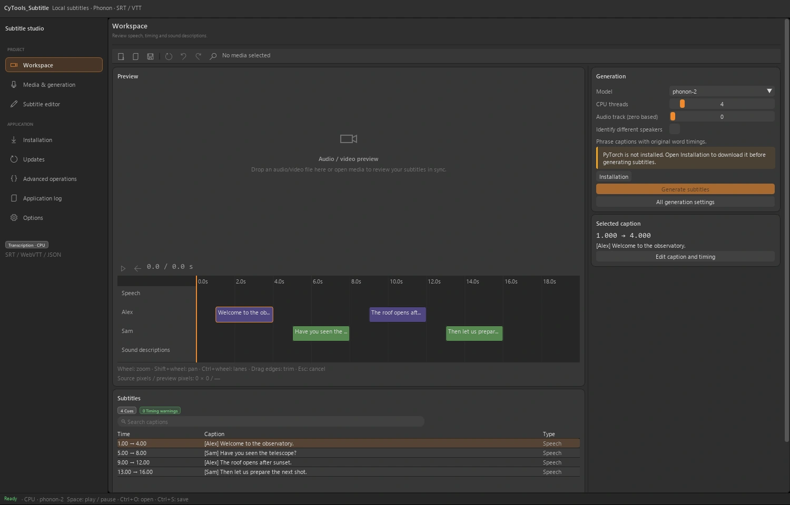
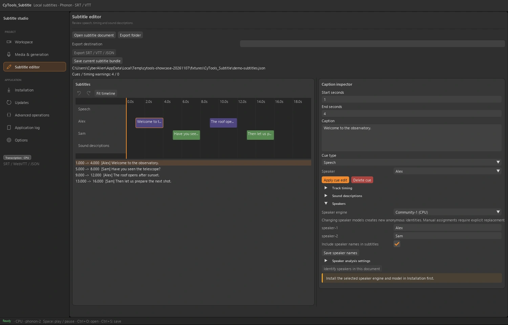

<table width="100%">
  <tr>
    <td width="300" align="left" valign="top">
      <a href="website/README.md#build-and-preview">Website (local build)</a><br>
      <a href="app/Documentation/Documentation.html#/en/overview">Offline documentation</a><br>
      <a href="https://github.com/MrMybal/CyTools_Subtitle">GitHub</a><br><br>
      <sub>README</sub><br>
      <a href="README.md">English</a> · <a href="README.fr.md">Français</a>
    </td>
    <td width="400" align="center" valign="middle">
      <strong>CyTools Subtitle</strong>
    </td>
    <td width="300" align="right" valign="top">
      <p><sub>Application license</sub><br><a href="LICENSE"><strong>AGPL-3.0-only</strong></a></p>
      <p><sub>Application version</sub><br><a href="VERSION.md"><strong>0.7.3</strong></a><br><strong>EXPERIMENTAL</strong></p>
      <p><a href="https://github.com/MrMybal/CyTools_Subtitle/releases/download/v0.7.3/CyTools_Subtitle-0.7.3-windows-x64.zip"><strong>Download</strong></a><br><sub>Windows x64 · portable · authorised account</sub></p>
    </td>
  </tr>
</table>

<h1 align="center">CyTools Subtitle</h1>


Transcribe local media, review word timing and edit captions with a synchronised player. Add optional speaker analysis and export the result. For video creators, editors and anyone who needs to review and correct a local subtitle document.

> **EXPERIMENTAL · 0.7.3**
>
> Published Windows build for evaluation; some engine paths remain unvalidated. Read the [version notes and known limitations](VERSION.md).

[](website/assets/showcase/workspace.webp)

*Subtitle workspace · hand-authored demo captions, not a transcription-quality claim.*


## The application

### Local transcription

Phonon transcription produces text and word timestamps from compatible local audio or video. Install the transcription runtime and model separately, then inspect the output in the application.

### Review & correction

Use the caption list, timeline and inspector to correct text and timing. Reflow lines and inspect timing warnings without replacing the original word evidence.

[](website/assets/showcase/editor.webp)

*Caption editor · sample dialogue and per-caption inspector.*


### Optional speaker analysis

Compatible Community-1 or NVIDIA Nemotron 3 components assign anonymous speaker IDs. You can rename speakers and override individual captions. These are labels for the recording, not automatic real-world identities.

## Features

- **Transcription:** Phonon local audio/video input, sequential windows and original word timestamps.
- **Review:** media preview, caption overlays, searchable cues, timeline seek/zoom/trim and inspector edits with undo/redo.
- **Corrections:** text and timing edits, line reflow, timing repair, track offsets and reviewer-supplied sound descriptions.
- **Speakers:** optional Community-1 or NVIDIA Nemotron 3 analysis, anonymous speaker IDs, names and manual per-caption overrides.
- **Delivery:** SRT, WebVTT and versioned JSON, reusable configurations and CLI/MCP operations. Transcription and speaker engines are installed separately.

**Desktop and automation:** English is the default interface language; French is selectable in Options. Save/load generation configurations, follow copyable application logs and use the declared operations through the CLI or MCP. The [manual](app/Documentation/Documentation.html#/en/overview) describes the real parameters and output contracts.

---

## Installation

The published application build is **Windows x64**. The portable ZIP includes its private Python runtime and base UI/media dependencies. Models and optional heavy engines are separate downloads.

1. [Download CyTools Subtitle 0.7.3](https://github.com/MrMybal/CyTools_Subtitle/releases/download/v0.7.3/CyTools_Subtitle-0.7.3-windows-x64.zip).
2. Extract the complete ZIP into a writable folder. Keep `app/` and `runtime/` beside the launcher.
3. Open **CyTools_Subtitle.exe**. Use the installation/model workspace for the components you need; review each component licence and any provider access conditions before download.

No machine Python is needed just to open the portable application. Source setup and some optional engine installers require additional tools such as Git. Keep the full release folder; the standalone `.exe` or an `app` update ZIP alone is not a complete installation.

Private GitHub repository: downloads require an authorised account. Windows x64 is tested; Linux and macOS remain unvalidated. Transcription runs on CPU. Optional NVIDIA speaker analysis can use CPU or CUDA. Translation and neural source separation are not implemented. Model access may require accepting provider terms.

This repository and its downloads require an authorised GitHub account. The in-app public-release downloader cannot authenticate a private release; download with your browser. The complete offline CyDoc reader ships in `app/Documentation/`.

### Updates and data

For an existing compatible installation, use its Updates page and the matching application update package. Keep `data/`, installed engines and models. An update for another runtime ABI must not be forced. If the required runtime changes, use the complete portable release in a separate folder and follow the migration instructions.

## Source, build and required libraries

<details>
<summary>Windows source setup and optional build tools</summary>


Use Python **3.11** for the base source environment. Git is needed for cloning and pinned Git requirements. Building the launcher needs the MSVC x64 Build Tools; use a developer command prompt.

```powershell
git clone https://github.com/MrMybal/CyTools_Subtitle.git
cd CyTools_Subtitle
powershell -File app\install.ps1
powershell -File app\build_launcher.ps1
.\CyTools_Subtitle.exe
```

The exact base requirements are in [app/requirements.txt](app/requirements.txt). Engines use their own environments and model catalogues; installing the base environment does not install them. Follow the [developer setup](app/README.md) for the detailed build and optional components.

</details>

---

## License

**CyTools Subtitle is licensed under [AGPL-3.0-only](LICENSE).** CyToolsCore, CyUI and CyDoc remain MIT components; their licences do not change the application licence. Optional engines, plugins and model weights retain their own terms.

### Main components and third-party libraries

| Library · source | License · terms | Use / scope |
| --- | --- | --- |
| [CyToolsCore 0.12.0](https://github.com/MrMybal/CyToolsCore) | [MIT](LICENCES/CyToolsCore-MIT.txt) | SDK/runtime: jobs, sessions, resources, CLI and MCP. |
| [CyMCPSDK 0.7.1](https://github.com/MrMybal/CyMCPSDK) | [MIT](LICENCES/CyMCPSDK-MIT.txt) | Native CLI, JSONL, HTTP and MCP. |
| [CyUI 1.2.0](https://github.com/MrMybal/CyUI) | [MIT](LICENCES/CyUI-MIT.txt) | Selected bundled Python UI modules. |
| [CyDoc 0.1.0](https://github.com/MrMybal/CyDoc) | [MIT](LICENCES/CyDoc-MIT.txt) | Bundled offline reader; Node/npm are authoring/build tools only. |
| [Dear ImGui / imgui-bundle](https://github.com/pthom/imgui_bundle) | [MIT + component notices](https://github.com/pthom/imgui_bundle/blob/main/LICENSE) | Desktop renderer and its bundled native components. |
| [CPython 3.11](https://www.python.org/) | [PSF + component notices](https://docs.python.org/3.11/license.html) | Private runtime included in the Windows portable archive. |
| [Phonon / fermion-research](https://github.com/fermionresearch/phonon) | [Apache-2.0](app/LICENCES/Phonon-Apache-2.0.txt) | Transcription integration; separately downloaded Phonon weights use CC-BY-4.0. |
| [PyAV / FFmpeg](https://github.com/PyAV-Org/PyAV) | [BSD-3-Clause; bundled FFmpeg GPL-3.0](app/LICENCES/FFmpeg-GPL-3.0.txt) | Media decoding and export; retain build and component notices. |
| [SciPy / Pillow / sounddevice](app/requirements.txt) | [BSD-3-Clause / MIT-CMU / MIT](app/licenses.json) | Base signal/image processing and audio playback. |
| [PyTorch](https://github.com/pytorch/pytorch) | [BSD-3-Clause](app/licenses.json) | Optional downloaded CPU runtime, not part of the base archive. |
| [Pyannote Audio / Community-1](https://github.com/pyannote/pyannote-audio) | [MIT (code); CC-BY-4.0 (weights)](LICENCES/PyannoteAudio-MIT.txt) | Optional CPU speaker analysis; access/terms may require a provider account. |
| [NVIDIA NeMo-Speech.cpp / Nemotron 3](https://github.com/NVIDIA/NeMo-Speech.cpp) | [Apache-2.0 (runtime); OpenMDW-1.1 (weights)](LICENCES/NeMo-Speech-Apache-2.0.txt) | Optional native CPU/CUDA speaker backend with separate model terms. |

This table indexes the main components; it does not replace their complete transitive notices. Retain [LICENCES/](LICENCES/), [app/licenses.json](app/licenses.json), the licences beside installed packages and the notices in each optional engine/model. CUDA libraries, when installed, also retain NVIDIA’s terms.

## References and links

- [Offline documentation](app/Documentation/Documentation.html#/en/overview)
- [Website (local build)](website/README.md#build-and-preview)
- [Source repository](https://github.com/MrMybal/CyTools_Subtitle) · [Releases and checksums](https://github.com/MrMybal/CyTools_Subtitle/releases)
- [Issue tracker](https://github.com/MrMybal/CyTools_Subtitle/issues) · [Version notes](VERSION.md)
- [Developer setup](app/README.md)

<details>
<summary><strong>AI Usage</strong></summary>

- [Start here: project agent guide](app/AGENTS.md) — product rules and important files.
- [Operations and AI integration](app/Documentation/DocAI.md) — actual tool contracts and task usage.
- [Build this application](app/README.md) — source setup and application-specific commands.

</details>


## Native AI communication

CyToolsCore **0.12.0** uses **CyMCPSDK 0.7.1** for native CLI, JSONL, HTTP and MCP. Discover all effective options with `ai_communication_status` (`includeOperations: true`). Export wanted task results before cleanup. This first migration requires the full Windows package; application-only updates are for installations that already have the native runtime.

Source-build dependency: `cytools-core @ https://github.com/MrMybal/CyToolsCore/releases/download/v0.12.0/cytools_core-0.12.0-py3-none-win_amd64.whl`. See [developer instructions](app/README.md) for native builds.


## Local MCP access

Core **0.12.0** embeds native CyMCPSDK commit **`34d4bca`**. From the Tool root, start
the local service explicitly:

```powershell
runtime/python/Scripts/python.exe app/tool.py --data-dir data/jobs serve --port 8766
```

Free is the initial profile: connect using only `http://127.0.0.1:8766/mcp`. All exposed
operations are callable without a token or additional transport approval. Arguments,
licence acceptance and explicit destructive-action confirmations remain business rules.
The portable API is at `/v1`; the listener binds only to 127.0.0.1.

Missing choices migrate to Free; explicit profiles are preserved. Use the server option
`--access-profile free`, `--access-profile local_controlled`, `--access-profile token_only`
or `--access-profile protected_access`. Local controlled applies host-selected permissions.
Token only and Protected require a valid token; Protected retains credential permissions.
With the command above, the choice persists in `data/jobs/communication.json`. Restart
the service to change the active profile. CLI/embedded and chat-provider permissions
are unchanged. Use `ai_communication_status` with `includeOperations: true` for discovery.

Install the full Windows package for this native runtime update; app-only updates reject
the old runtime ABI. For a local source upgrade, install the bundled wheel:

```powershell
runtime/python/Scripts/python.exe -m pip install --no-deps app/packages/cytools_core-0.12.0-py3-none-win_amd64.whl
```

Export wanted task files before `cy_finish_task`. Task cleanup preserves original inputs,
installed models, conversations and persistent project documents. Windows x64 is the
validated platform for this update; Linux/macOS native builds require target validation.
